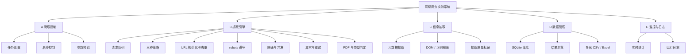
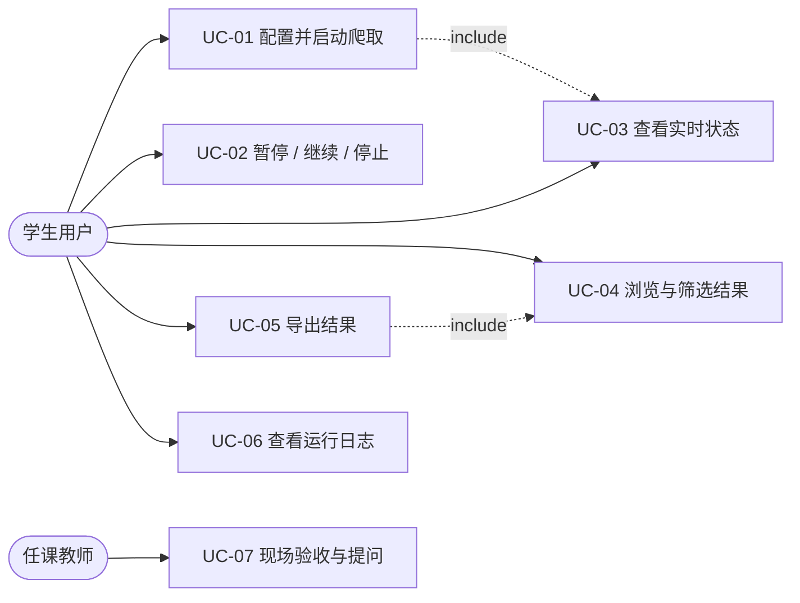

# 需求分析报告

| 项目 | 内容 |
|---|---|
| 项目名称 | 网络爬虫实验系统（教学型网络爬虫） |
| 课程 | 《网络系统实践》（950012Z11）· 选题一：网络爬虫的设计与实现 |
| 文档编号 | NSP-CRAWLER-SRS-01 |
| 版本 | v1.0 |
| 编写 | 【填写姓名 / 学号】 |
| 日期 | 2026-11-25 |
| 状态 | 已评审，作为设计与实现的依据 |

> **填写说明**：文中以【】标注的位置为需要本人补充的内容（用户访谈记录、姓名学号等），其余为已完成的分析，可直接使用或按实际情况微调。

---

## 1. 引言

### 1.1 编写目的

本文档定义"网络爬虫实验系统"的功能需求、非功能需求、数据与接口需求及验收标准，作为后续体系设计、编码实现、测试验收和课程答辩的统一依据。预期读者为：开发者本人（学生）、课程指导教师（验收方）、以及同选题同学（协作与评审）。

### 1.2 项目背景

本课程要求从五个选题中择一完成完整的设计与实现，并接受现场演示与提问（占总评 50%），另提交实践报告（40%）。选题一要求实现一个**带图形界面**的网络爬虫，能按策略爬取网页、遵守 robots 协议、去重、限速、抽取标题/作者/摘要/关键词/发表时间/URL 等关键信息并保存，同时提供启停控制、状态展示与日志记录。

现有可用的开源方案（如 Scrapy）虽功能完备，但把队列调度、去重、限速等核心机制封装为配置项，无法满足本课程"针对关键问题设计算法并通过测试完善算法"的考核要求。因此本项目**自底向上实现爬取引擎**，仅借助 HTTP 与 HTML 解析的基础库。

### 1.3 术语与缩略语

| 术语 | 含义 |
|---|---|
| 种子 URL（Seed） | 爬取的起始地址，一切链接由它派生 |
| Frontier | 请求队列（待抓取 URL 的有序集合），决定爬取顺序 |
| BFS / DFS / Best-First | 广度优先 / 深度优先 / 最佳优先（按优先级取任务） |
| robots.txt | 站点根目录下的爬虫访问约定文件，RFC 9309 标准化 |
| UA（User-Agent） | 请求头中的客户端标识，本项目使用可识别的固定值 |
| URL 规范化 | 把同一资源的不同 URL 写法统一为唯一形式，是去重的前提 |
| 限速（Rate Limit） | 对同一域名单位时间内的请求次数限制 |
| 抽取链 | 按优先级依次尝试的多级字段提取策略（元数据 → DOM → 正则） |
| WAL | SQLite 的 Write-Ahead Logging 日志模式，提升读写并发 |
| 事件桥 | 工作线程通过 `queue.Queue` 向界面线程单向传递状态消息的机制 |

### 1.4 参考资料

1. 《网络系统实践》教学大纲（950012Z11，2025）五、实践教学内容，选题（1）
2. RFC 9309 — Robots Exclusion Protocol
3. 詹姆斯·F. 库罗斯. 计算机网络：自顶向下方法（原书第 8 版）. 机械工业出版社, 2022
4. Python 3 官方文档：`urllib.robotparser`、`sqlite3`、`tkinter`、`concurrent.futures`
5. 项目内《实验规划-网络爬虫.md》（五周实施计划与算法要点）

---

## 2. 项目概述

### 2.1 产品定位

一个**单机、桌面、教学用途**的可视化网络爬虫：用户输入种子地址与策略参数，点击"开始"即可观察爬取全过程，并在结束后浏览、筛选、导出结构化结果。不追求分布式与百万级规模，追求**机制清晰、过程可视、行为合规**。

### 2.2 用户特征

| 用户角色 | 特征 | 关键诉求 |
|---|---|---|
| 学生（开发者） | 有 C/C++ 基础，Python 入门 | 代码可读、可调试、能讲清算法 |
| 同选题同学（评审） | 关注实现思路 | 模块边界清晰、可复用 |
| 任课教师（验收） | 现场演示 + 提问 | 稳定、可解释、符合大纲四条要求 |
| 目标网站站长（被动方） | 不希望被过度请求 | 遵守 robots、限速、UA 可识别 |

### 2.3 运行环境

| 项 | 要求 |
|---|---|
| 操作系统 | Windows 10 / 11（64 位），兼容 macOS / Linux |
| 运行时 | Python 3.10 及以上（开发与验收使用 3.14.4） |
| 依赖 | `requests`、`beautifulsoup4`（可选 `lxml`），其余全部使用标准库 |
| 显示 | 分辨率 ≥ 1280×800，能显示 1000×650 窗口 |
| 网络 | 可访问目标站点（演示环节使用本地测试站点，不依赖外网） |

### 2.4 约束与假设

| 编号 | 约束/假设 | 影响 |
|---|---|---|
| C-01 | 单人开发，总工期约 5 周 | 功能必须分级，P2 可裁剪 |
| C-02 | 不使用爬虫框架 | 调度、去重、限速需自行实现 |
| C-03 | 界面技术限标准库（Tkinter） | 不支持复杂动画/图表，用表格与进度条表达状态 |
| C-04 | 单机运行，无服务端 | 无并发用户、无鉴权需求 |
| C-05 | 目标站点可能反爬或改版 | 演示必须有本地测试站点兜底 |
| A-01 | 假设用户具备基本网络常识 | 参数非法时给出明确提示即可，不做引导式向导 |

### 2.5 范围界定（不做什么）

明确排除以下内容，避免范围蔓延：

- **不做** JS 动态渲染（不集成 Selenium/Playwright），仅在局限性中说明；
- **不做** 登录态抓取、验证码识别、代理池与反反爬；
- **不做** 分布式爬取与多机协同；
- **不做** PDF 全文解析（仅识别与登记链接）；
- **不做** 数据可视化大屏（图表由导出后在 Excel 中完成）。

---

## 3. 干系人与需求来源

### 3.1 干系人分析

| 干系人 | 关注点 | 对需求的影响 |
|---|---|---|
| 任课教师 | 是否覆盖大纲四条要求、能否现场解释 | 四种机制必须可演示、可提问（FR-07~FR-17） |
| 学生本人 | 五周内完成、能讲清算法 | 功能分级、模块化（NFR-07） |
| 同选题同学 | 能否借用测试站点与代码片段 | 测试站点与配置项需可复用 |
| 目标站点 | 是否被过度请求 | 限速、robots、UA 标识（NFR-08） |
| 潜在使用者（如做文献综述的同学） | 能否快速拿到结构化结果 | 六字段完整度、导出（FR-19、FR-24） |

### 3.2 用户调研方法与记录

采用**半结构化访谈**（每人 10~15 分钟），对象 2 人：①一位有文献检索需求的同专业同学；②一位曾使用爬虫脚本采集公开数据的学长。访谈提纲见附录 A。

| 编号 | 受访者 | 原话摘要 | 提炼的需求 | 落到哪条需求 |
|---|---|---|---|---|
| I-01 | 【填写】 | 【填写，例："一条条复制标题太慢了，希望能直接导出表格"】 | 【填写】 | 【填写，例：FR-24】 |
| I-02 | 【填写】 | 【填写】 | 【填写】 | 【填写】 |
| I-03 | 【填写】 | 【填写】 | 【填写】 | 【填写】 |

> 说明：以上三条须由本人实际访谈后填写。**不要编造**——答辩时老师很可能追问"你访谈了谁、他原话是什么"，答不上来比不写更糟。若确实约不到人，可改为"对同选题同学的 3 次讨论记录"，同样有效（对应课程目标 6）。

### 3.3 需求来源汇总

需求来源共四类：①教学大纲的四条硬性要求；②课程考核方式（演示 50% / 报告 40%）反推的质量要求；③用户访谈；④开发约束（单人、五周、Tkinter）。

---

## 4. 功能需求

### 4.1 功能结构

### 4.2 用例视图

### 4.3 用例描述

**UC-01 配置并启动爬取**

| 项 | 内容 |
|---|---|
| 参与者 | 学生用户 |
| 前置条件 | 程序已启动；种子 URL 至少一条 |
| 主流程 | 1) 输入种子 URL；2) 选择策略与参数（深度/页数/间隔/并发/同域/robots/PDF）；3) 点击"开始"；4) 系统校验参数；5) 引擎初始化（建库、加载 robots、入队种子）；6) 界面进入"运行中"，统计与日志开始刷新 |
| 异常流 | 4a) URL 非法或参数越界 → 弹窗提示，不启动；5a) 数据库不可写 → 提示路径并中止；5b) 种子站点不可达 → 记录错误，队列留空后自动结束 |
| 后置条件 | 结果逐步写入数据库；界面持续显示进度 |

**UC-02 暂停 / 继续 / 停止**

| 项 | 内容 |
|---|---|
| 前置条件 | 状态为"运行中" |
| 主流程 | 暂停：置暂停标志，不再派发新任务，在飞请求完成后停止出队；继续：清标志，恢复出队；停止：置停止标志并取消未开始的任务，5 秒内线程结束 |
| 异常流 | 停止时线程 5 秒未退出 → 记录警告并强制回收，界面仍回到"已结束" |
| 后置条件 | 已抓数据完整落库，无残留线程 |

**UC-03 查看实时状态**：界面每 120 ms 批量取事件队列，刷新"已抓/待抓/失败/去重/robots 拦截/PDF/速率/耗时"与进度条。

**UC-04 浏览与筛选结果**：表格展示六字段；支持按站点、是否成功、关键词过滤与按时间排序；双击查看摘要全文。

**UC-05 导出结果**：选择保存路径，导出当前筛选结果为 CSV（UTF-8-BOM，Excel 直接打开不乱码）或 xlsx。

**UC-06 查看运行日志**：界面日志区滚动显示；同时写入 `logs/crawl_YYYYMMDD.log`，可按级别过滤。

**UC-07 现场验收与提问**：教师观察演示流程，就队列实现、去重方案、robots 处理、限速位置、线程模型、数据准确性提问。

### 4.4 功能需求清单

优先级：**P0** 必须实现（缺一不可）、**P1** 应当实现（影响评分）、**P2** 可选（时间富余再做）。

| 编号 | 需求名称 | 描述 | 优先级 | 验收标准 | 来源 |
|---|---|---|---|---|---|
| FR-01 | 种子配置 | 支持输入 1~N 条种子 URL，自动补全协议、去空格、校验合法性 | P0 | 输入 `www.python.org` 能自动补成 `https://` 或提示补全；非法串给出原因 | 大纲 1 |
| FR-02 | 策略选择 | 界面可在 BFS / DFS / 最佳优先间切换，运行中置灰 | P0 | 三种策略均可选中并生效，日志打印当前策略 | 大纲 1 |
| FR-03 | 抓取参数 | 最大深度、最大页数、请求间隔、并发数可配 | P0 | 参数生效，边界值（深度 0、页数 1、间隔 0.1）不崩溃 | 大纲 1、3 |
| FR-04 | 启停控制 | 开始 / 暂停 / 继续 / 停止四个动作，状态互斥 | P0 | 任意顺序点击不出现非法状态；停止后线程 5 秒内结束 | 大纲 4 |
| FR-05 | 参数校验 | 非法输入阻止启动并提示 | P0 | 空种子、深度 > 10、间隔 ≤ 0 均被拦截 | 大纲 4 |
| FR-06 | 优雅退出 | 运行中关闭窗口能安全结束 | P0 | 关窗后进程退出、数据完整、无 Traceback 弹窗 | 大纲 4 |
| FR-07 | 请求队列 | 先进先出的待抓集合，支持入队、出队、长度查询 | P0 | 单测覆盖三种策略的出队顺序 | 大纲 1 |
| FR-08 | 广度优先 | 按层扩展，FIFO 出队 | P0 | 抓取序列的深度单调不减 | 大纲 1 |
| FR-09 | 深度优先 | 沿单链深入，LIFO 出队 | P0 | 先抓完一条链再回头 | 大纲 1 |
| FR-10 | 最佳优先 | 按优先级（相关度、深度、类型）取任务 | P1 | 前 50 页相关命中数高于 BFS（实验数据佐证） | 大纲 1 |
| FR-11 | URL 规范化 | 大小写、默认端口、点段、末尾斜杠、fragment、跟踪参数、query 排序、协议白名单 | P0 | 10 条规范化用例全部通过 | 大纲 1 |
| FR-12 | URL 去重 | 规范化后哈希集合去重，数据库 UNIQUE 兜底 | P0 | 同页不同写法只抓一次；`dup` 计数准确 | 大纲 1 |
| FR-13 | robots 遵守 | 抓取并解析 robots.txt，遵守 Disallow/Allow，按 host 缓存 | P0 | 被禁路径不抓，日志可见；404 视为允许 | 大纲 1 |
| FR-14 | 限速 | 同一域名两次请求间隔不小于设定值 | P0 | 抓 10 页耗时 ≥ 9×间隔（误差 < 15%） | 大纲 3 |
| FR-15 | 抓取范围控制 | 同域限制、深度限制、页数上限、后缀黑名单、`nofollow` | P0 | 外站链接不入队；图片/压缩包被跳过并计数 | 大纲 1 |
| FR-16 | 异常与重试 | 超时/连接失败/429/403/404/5xx 分类处理，指数退避 | P0 | 断网运行不崩溃，日志含错误类型；429 后该域间隔加倍 | 大纲 3 |
| FR-17 | PDF 链接处理 | 按后缀与 Content-Type 识别，登记到独立表，不解析正文 | P1 | PDF 不进 `pages` 表，`pdf_links` 表有记录 | 大纲 1 |
| FR-18 | 编码识别 | 响应缺少 charset 时按内容推断，中文不乱码 | P0 | 抓 GBK 中文站点标题正常显示 | 大纲 2 |
| FR-19 | 六字段抽取 | 标题、作者、摘要、关键词、发表时间、URL | P0 | 正文页字段有值率 ≥ 70% | 大纲 2 |
| FR-20 | 兜底抽取 | 元数据缺失时用 `h1`/`title`/正文日期正则/描述标签 | P0 | 无 meta 的页面仍能取到标题与日期 | 大纲 2 |
| FR-21 | 抽取质量标记 | 记录成功/失败与失败原因 | P0 | 失败页面 `ok=0` 且有 `error` 文本 | 大纲 3 |
| FR-22 | 数据持久化 | 结果写入 SQLite，字段与索引齐备 | P0 | 重启后数据可读；500 条写入 < 3 秒 | 大纲 2 |
| FR-23 | 结果浏览 | 表格展示，支持过滤、排序、查看详情 | P1 | 500 行滚动不卡顿 | 大纲 4 |
| FR-24 | 结果导出 | CSV（默认）与 Excel（可选） | P0 | Excel 打开中文不乱码，行数一致 | 大纲 2 |
| FR-25 | 实时统计 | 已抓/待抓/失败/去重/robots 拦截/PDF/速率/耗时 | P0 | 数字随抓取实时变化 | 大纲 3、4 |
| FR-26 | 日志 | 文件日志 + 界面日志，含时间、级别、URL、耗时、错误 | P0 | 事后可凭日志定位任一失败请求 | 大纲 3 |
| FR-27 | 断点续爬 | 队列落库，重启后可继续上次任务 | P2 | 关闭后重开提示"继续上次"，队列恢复 | 加分项 |

---

## 5. 非功能需求

| 编号 | 类别 | 需求 | 可度量指标 |
|---|---|---|---|
| NFR-01 | 性能 | 单页平均处理时间（含限速等待）可控 | 间隔 0.5 s、单线程时 100 页 ≤ 90 s |
| NFR-02 | 性能 | 界面操作响应及时 | 点击按钮到状态变化的反馈 ≤ 200 ms；日志显示延迟 ≤ 300 ms |
| NFR-03 | 资源 | 内存占用可接受 | 5000 条 URL 在队时进程内存 ≤ 500 MB |
| NFR-04 | 可靠性 | 长时间运行不崩溃 | 连续运行 2 小时或 1000 页无崩溃、无内存持续增长 |
| NFR-05 | 可靠性 | 网络异常不影响进程 | 断网、超时、DNS 失败均被捕获，程序继续 |
| NFR-06 | 可恢复 | 数据不因异常退出而损坏 | 强制结束进程后数据库仍可打开，已提交数据完整 |
| NFR-07 | 易用性 | 新用户可快速上手 | 首次使用 3 分钟内完成"输入种子 → 开始 → 看到结果" |
| NFR-08 | 易用性 | 错误提示可执行 | 提示包含"发生了什么 + 建议怎么做"，不使用裸 Traceback 面向用户 |
| NFR-09 | 可维护性 | 模块边界清晰、可测试 | 核心算法（规范化/队列/过滤）单测覆盖 ≥ 60% |
| NFR-10 | 合规性 | 抓取行为合法克制 | 遵守 robots；默认 1 请求/秒/域；UA 含项目标识与联系方式 |
| NFR-11 | 合规性 | 不采集个人信息 | 不解析手机号/身份证/住址等字段；无相关字段定义 |
| NFR-12 | 可移植性 | 换机器可快速复现 | 三条命令（建环境、装依赖、运行）内可启动 |
| NFR-13 | 可观测性 | 问题可定位 | 日志含 `url`、`elapsed_ms`、`error` 三类字段 |
| NFR-14 | 安全性 | 不执行抓取内容 | 不 `eval`/不打开下载的可执行文件；解析仅做文本提取 |

---

## 6. 数据需求

### 6.1 数据项

| 数据项 | 类型 | 必填 | 说明 |
|---|---|---|---|
| url | 文本 | 是 | 规范化后的绝对 URL，唯一 |
| title | 文本 | 否 | ≤ 300 字符 |
| authors | 文本 | 否 | 多人以 `; ` 分隔，去重排序 |
| abstract | 文本 | 否 | ≤ 1000 字符，缺失时为空 |
| keywords | 文本 | 否 | 保留原文分隔符 |
| publish_date | 日期 | 否 | 统一 `YYYY-MM-DD`，无法识别时为空 |
| site | 文本 | 是 | 域名，用于分组统计 |
| depth / parent_url | 整数 / 文本 | 是 | 支持来源追溯与策略分析 |
| http_status / elapsed_ms | 整数 | 是 | 质量与性能分析 |
| ok / error | 布尔 / 文本 | 是 | 抽取质量标记 |

### 6.2 数据量与保留

- 单次实验规模：100~1000 页；数据库体积约 0.5~5 MB。
- 保留策略：元数据长期保留；原始 HTML **不落盘**（仅内存中解析），降低存储与版权风险。
- 清理：提供"清空本次结果"操作，删除前二次确认。

### 6.3 数据质量要求

- 去重率：同一站点重复入库应为 0；
- 字段完整率：正文类页面六字段整体有值率 ≥ 70%，其中标题 ≥ 95%、时间 ≥ 60%；
- 时间格式一致性：100% 为 `YYYY-MM-DD` 或空。

---

## 7. 外部接口需求

| 接口 | 说明 | 约束 |
|---|---|---|
| UI 接口 | 桌面窗口（Tkinter），鼠标键盘操作 | 中文界面，1280×800 下不遮挡 |
| HTTP 接口 | 通过 `requests` 访问目标站点 | 必带 UA、超时 10 s、遵守 robots |
| robots 接口 | GET `/robots.txt` | 按 host 缓存 1 小时，失败降级策略见设计文档 |
| 数据库接口 | SQLite 单文件 `data/crawl.db` | WAL 模式，单写者 |
| 文件接口 | 日志 `logs/`、导出 `*.csv` | UTF-8（CSV 带 BOM） |
| 剪贴板 | 复制结果行 URL（P2） | — |

本项目**不提供**网络服务端接口（无 HTTP API、无多用户）。

---

## 8. 需求优先级与版本规划

| 版本 | 范围 | 对应周次 |
|---|---|---|
| v0.1 CLI | FR-07~FR-18（无界面，命令行驱动） | 第 1 周 |
| v0.2 Core | 增加 FR-19~FR-22、FR-25、FR-26 | 第 2 周 |
| v0.9 GUI | 增加 FR-01~FR-06、FR-23、FR-24 | 第 3 周 |
| v1.0 | 补 FR-10 实验调参、稳定性达标（NFR-01~06） | 第 4 周 |
| v1.1（可选） | FR-27 断点续爬、Excel 导出、日志级别过滤 | 第 5 周 |

裁剪原则：时间不足时按 P2 → P1 顺序裁剪，**FR-07~FR-26 中的 P0 项不得裁剪**。

---

## 9. 验收标准

### 9.1 对照教学大纲

| 大纲要求 | 满足情况 | 对应需求 |
|---|---|---|
| 基于请求队列的广度/深度/最佳优先策略（至少一种以上） | 三种全部实现，可切换 | FR-07~FR-10 |
| Robots 协议解析与遵守 | 自抓 + 解析 + 缓存 + 通配符补齐 | FR-13 |
| URL 去重、PDF 链接 | 8 条规范化 + 双重去重 + PDF 独立登记 | FR-11、FR-12、FR-17 |
| 提取标题/作者/摘要/关键词/时间/URL 并保存 | 三级抽取链 + SQLite + 导出 | FR-19~FR-22、FR-24 |
| 爬取速率控制 | 按域限速 + 并发上限 | FR-14 |
| 监控状态、记录日志 | 实时统计 + 双通道日志 | FR-25、FR-26 |
| 异常处理 | 分类处理 + 退避重试 + 熔断 | FR-16 |
| 界面友好、可控启停、显示状态与结果 | 参数面板 + 四按钮 + 表格 + 进度条 | FR-01~FR-06、FR-23 |

### 9.2 演示验收脚本（教师视角，5 分钟）

1. 打开程序 → 输入 `http://127.0.0.1:8000/` → 开始 → 观察日志与统计跳动（1 分钟）。
2. 暂停 → 继续 → 停止 → 再次开始（验证状态机，1 分钟）。
3. 切换策略为"最佳优先"重跑 100 页 → 对比前 50 页相关度（1 分钟）。
4. 打开数据库/导出 CSV → 展示六字段（1 分钟）。
5. 提问环节：队列、去重、robots、限速、线程模型（1 分钟起）。

---

## 10. 需求追踪矩阵

| 大纲条目 | 功能需求 | 用例 | 设计章节（见《体系设计报告》） | 测试用例 |
|---|---|---|---|---|
| 三种爬取策略 | FR-02、FR-07~FR-10 | UC-01 | §5.2、§6.2、§10.3 | T06、T07 |
| robots | FR-13 | UC-01 | §5.2、§10.5 | T10、T11 |
| 去重 / PDF | FR-11、FR-12、FR-17 | UC-01 | §10.1、§10.2 | T01~T06、T12 |
| 六字段抽取 | FR-19~FR-22 | UC-04 | §5.2、§8 | T17 |
| 速率控制 | FR-03、FR-14 | UC-01 | §10.4 | T13 |
| 状态与日志 | FR-25、FR-26 | UC-03、UC-06 | §9、§11 | T15、T16 |
| 异常处理 | FR-16、FR-21 | UC-01 | §11 | T15 |
| 图形界面 | FR-01~FR-06、FR-23、FR-24 | UC-01~UC-05 | §9 | T18~T20 |

---

## 11. 风险与假设（需求层）

| 风险 | 影响 | 应对 |
|---|---|---|
| 目标站点改版或反爬 | 演示数据抓不到 | 本地测试站点 + 提前跑好的数据集 |
| 演示环境断网 | 无法现场抓取 | 本地 `http.server` 全离线演示 |
| 五周工期被其他课程挤占 | 功能裁剪 | 按 §8 版本规划，保 P0 |
| 单人开发缺少评审 | 设计盲点 | 与同选题同学互审（课程目标 5） |
| 需求膨胀（想加可视化图表等） | 延期 | §2.5 范围界定，超范围一律记为"展望" |

---

## 附录 A：用户访谈提纲

1. 你最近一次需要批量收集网上信息是什么场景？怎么做的？
2. 手动复制粘贴最烦的是哪一步？（标题？时间？链接？）
3. 如果有个工具能自动抓并导出表格，你最希望表格里有哪几列？
4. 你会在意抓取速度吗？能接受"1 秒 1 页"吗？
5. 如果界面上只能保留三个数字，你希望是哪三个？
6. 你遇到过网页打不开/超时的情况吗？你希望工具怎么提示？

## 附录 B：调研结论如何影响设计（示例，替换为真实内容）

| 访谈发现 | 设计决策 |
|---|---|
| 用户最需要"能直接进 Excel" | 导出列为 P0，且 CSV 使用 UTF-8-BOM |
| 用户不关心技术细节，只关心"抓了多少、还剩多少" | 统计区突出进度与待抓数，弱化内部指标 |
| 用户会被"卡住没反应"劝退 | 日志实时刷新 + 每 120 ms 批量更新，保证界面始终有反馈 |

---

## 附录 C：实现偏差说明（v1 复核，2026-11-25）

本报告写的是设计目标，实际实现存在以下偏差，完整清单见《项目现状与差距分析》（docs/03）。

| 需求 | 状态 | 说明 |
|---|---|---|
| FR-17 PDF 链接处理 | 部分实现 | 识别与登记已完成；原计划的"可选下载"未实现，列 v2 |
| FR-23 结果浏览 | 部分实现 | 表格展示与双击详情已完成；筛选/排序/分页未实现 |
| FR-24 导出 | 部分实现 | CSV 已完成；Excel 未实现 |
| FR-27 断点续爬 | 未实现 | 列为 v2 |
| FR-10 最佳优先 | 已实现未调参 | 优先级权重尚未用对比实验标定 |