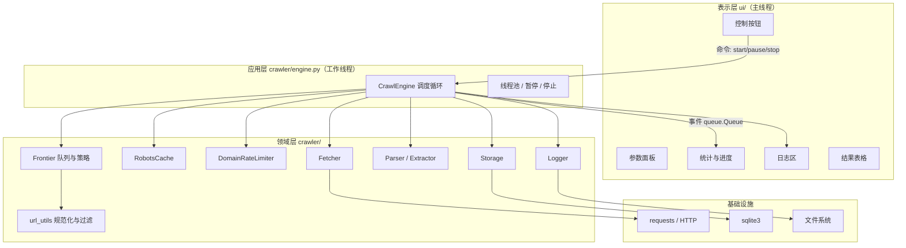
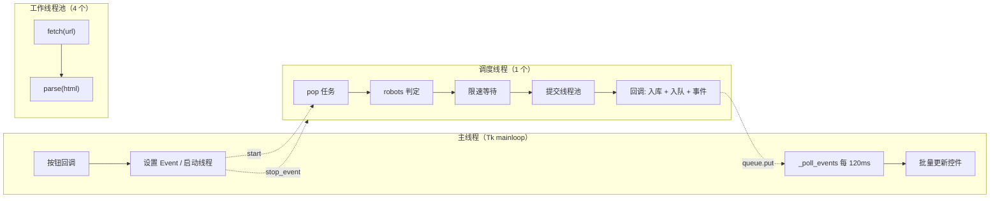
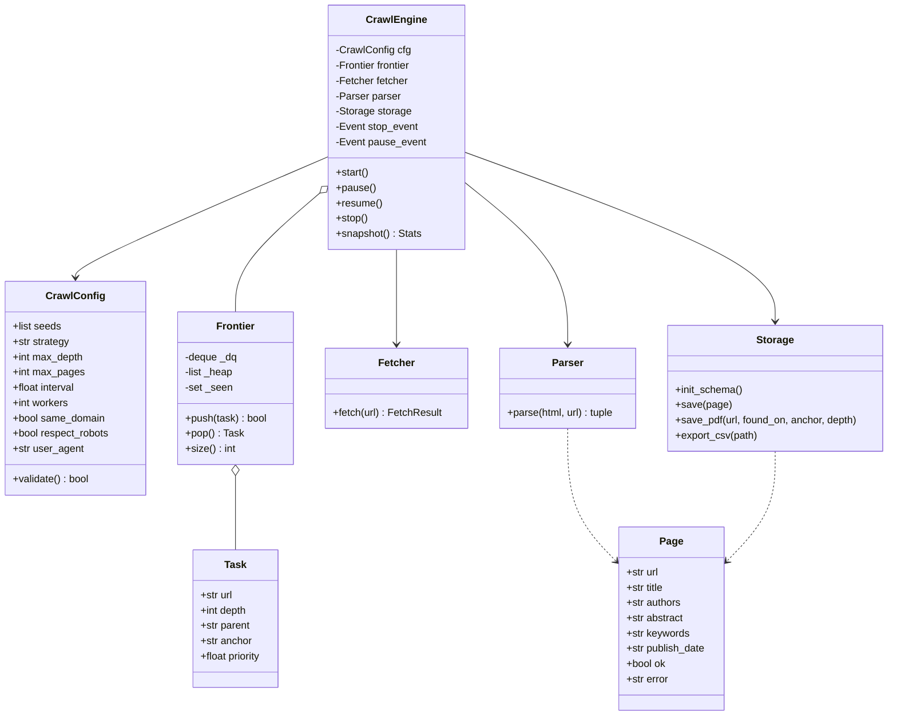
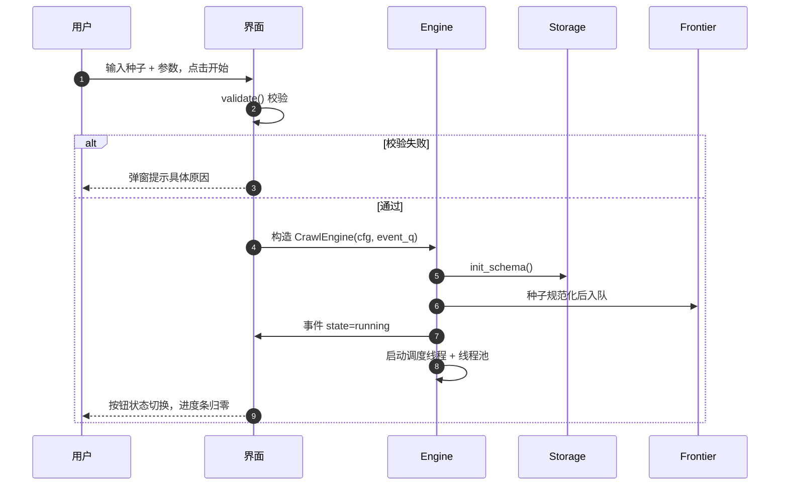
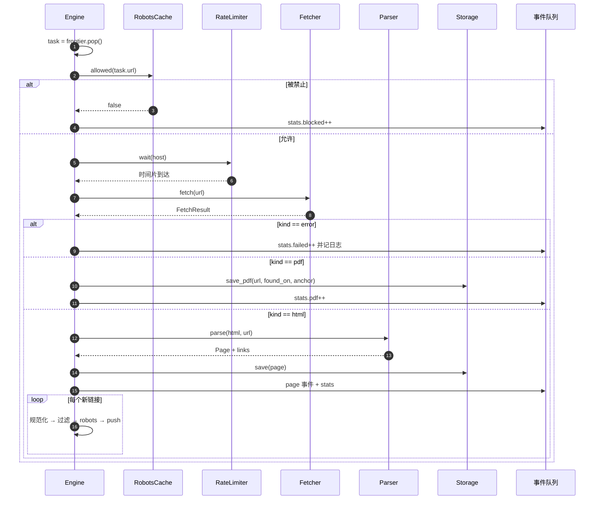
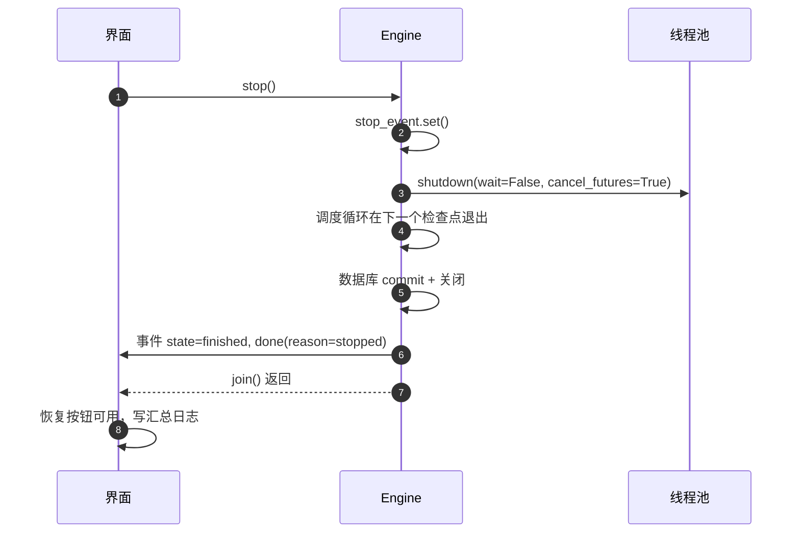
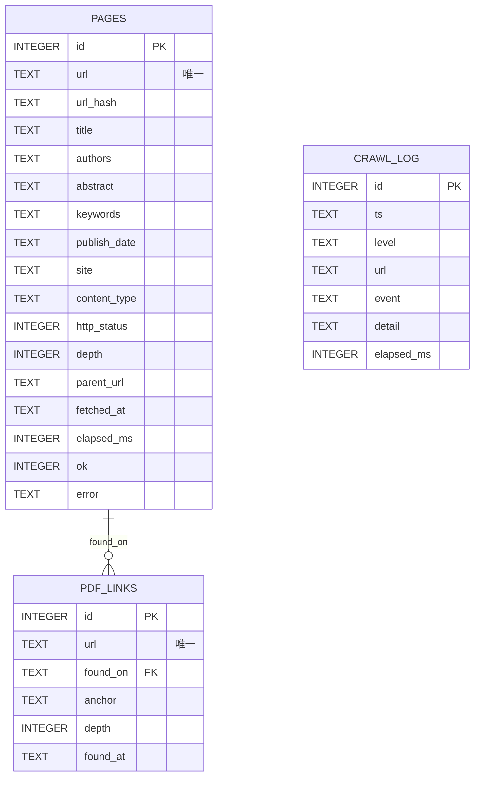
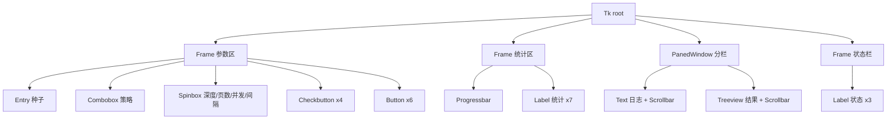
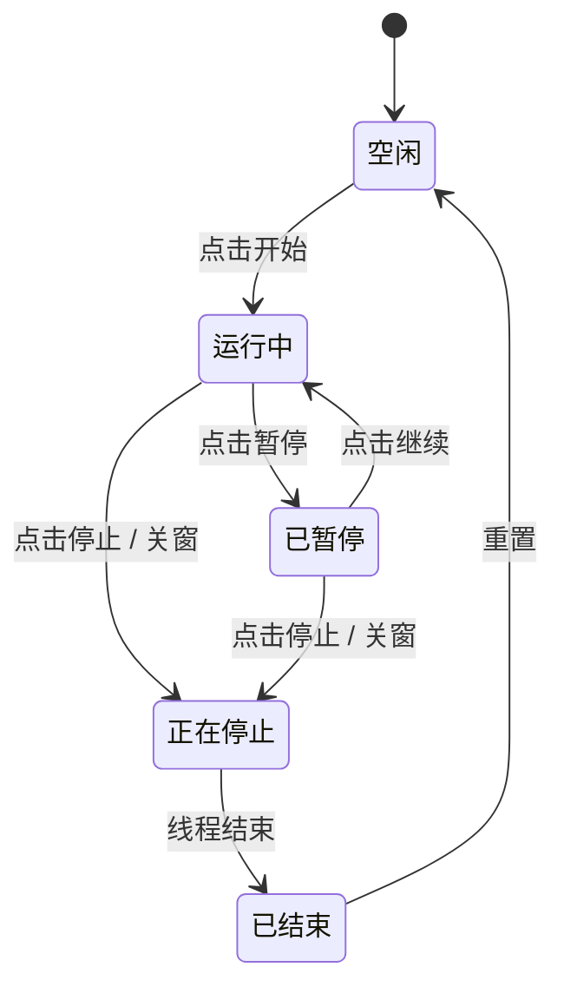

# 体系设计报告

| 项目 | 内容 |
|---|---|
| 项目名称 | 网络爬虫实验系统（教学型网络爬虫） |
| 课程 | 《网络系统实践》（950012Z11）· 选题一 |
| 文档编号 | NSP-CRAWLER-SDD-01 |
| 版本 | v1.0 |
| 编写 | 【填写姓名 / 学号】 |
| 日期 | 2026-11-25 |
| 依据 | 《需求分析报告》NSP-CRAWLER-SRS-01 v1.0 |
| 状态 | 已评审，作为编码实现的依据 |

> **填写说明**：以【】标注处需本人补充。文中所有性能数字为**设计目标**，实测数据在《测试与实验报告》中给出，不要混用。

---

## 1. 引言

### 1.1 目的

把《需求分析报告》中的 27 条功能需求与 14 条非功能需求，落实为可编码的架构、模块、接口、数据结构与流程，回答"系统由哪些部分组成、它们如何协作、为什么这样划分"。

### 1.2 范围

覆盖 v1.0 全部 P0/P1 需求（FR-01~FR-26）。P2 的断点续爬（FR-27）只做接口预留，不在本期实现。

### 1.3 设计依据

教学大纲四条要求、《需求分析报告》、Python 标准库能力边界（`urllib.robotparser` 不支持通配符、Tkinter 仅主线程可更新控件、SQLite 默认禁止跨线程使用连接）。

---

## 2. 设计目标与原则

| 编号 | 原则 | 落地方式 |
|---|---|---|
| P-01 | **关注点分离** | 界面只负责显示与收集输入，不含任何抓取逻辑；引擎不 import 任何 `tkinter` 模块 |
| P-02 | **依赖单向** | `ui → engine → {frontier, fetcher, parser, storage}`；下层不得反向依赖上层 |
| P-03 | **可测试** | 核心算法（规范化、队列、过滤、抽取）为纯函数或纯内存类，不依赖网络即可单测 |
| P-04 | **失败隔离** | 单页任何异常不得终止整轮任务；异常分类后记录并继续 |
| P-05 | **资源有界** | 队列、并发、重试、单页大小、PDF 下载均有上限 |
| P-06 | **行为可解释** | 每个决策点都写日志（为何跳过、为何重试），便于答辩时回答"为什么" |
| P-07 | **演示优先** | 任何外部依赖都要有本地等价物（本地测试站点），断网也能演示 |

---

## 3. 总体架构

### 3.1 分层结构



**依赖规则**：`ui` 可以 import `crawler`，`crawler` 绝不 import `ui`。这条规则的直接收益是——**引擎可以在没有界面的情况下用命令行跑通**（v0.1 阶段的 CLI 版本正是这样验证的）。

### 3.2 分层职责

| 层 | 目录 | 职责 | 不做什么 |
|---|---|---|---|
| 表示层 | `ui/` | 布局、输入收集、状态展示、状态机、事件消费 | 不发 HTTP、不解析 HTML、不写数据库 |
| 应用层 | `crawler/engine.py` | 调度：取任务→判定→抓取→解析→入库→入队；暂停/停止；统计 | 不关心界面长什么样 |
| 领域层 | `crawler/*.py` | 队列、规范化、robots、限速、抓取、解析、存储、日志 | 不感知线程调度 |
| 基础设施 | 标准库/三方库 | HTTP、SQLite、文件 | — |

### 3.3 运行时视图（线程模型）



线程设计要点（对应 NFR-02、NFR-04）：

1. **界面线程只做界面**。Tkinter 不是线程安全的，工作线程直接改控件会随机崩溃或假死。
2. **调度线程单写数据库**。SQLite 连接默认 `check_same_thread=True`，跨线程共享连接会抛异常；即便关掉检查，多写者也会导致 `database is locked`。故确立"单写者"模型。
3. **网络请求在线程池**。IO 密集，4 个 worker 足够；再加会被目标站点限流，收益为负。
4. **停止是协作式的**。`stop_event.set()` → 调度循环退出 → `pool.shutdown(cancel_futures=True)` → `join(5)`。绝不 `kill` 线程（Python 没有安全的线程终止手段）。

### 3.4 部署视图

单机、无服务端。运行目录即项目目录：

```
项目根/
├─ run.py            ← 入口
├─ crawler/          ← 代码
├─ ui/
├─ data/crawl.db     ← 运行期生成
└─ logs/crawl_*.log  ← 运行期生成
```

---

## 4. 模块设计

### 4.1 模块清单

| 模块 | 文件 | 职责 | 对外接口 | 依赖 |
|---|---|---|---|---|
| 配置 | `crawler/config.py` | 参数集中定义与校验 | `CrawlConfig`、`validate()` | 无 |
| URL 工具 | `crawler/url_utils.py` | 规范化、同域判断、后缀过滤、链接抽取 | `normalize_url`、`should_visit` | 标准库 |
| 队列 | `crawler/frontier.py` | 三种策略的入队/出队/去重 | `Frontier` | url_utils |
| robots | `crawler/robots.py` | 抓取、解析、缓存、通配符匹配 | `RobotsCache.allowed()` | requests |
| 限速 | `crawler/ratelimit.py` | 按域名最小间隔 | `DomainRateLimiter.wait()` | 无 |
| 抓取 | `crawler/fetcher.py` | HTTP、重试、编码、类型判定 | `Fetcher.fetch()` | requests |
| 解析 | `crawler/parser.py` | 六字段抽取、链接抽取 | `Parser.parse()` | bs4 |
| 存储 | `crawler/storage.py` | 建表、写入、查询、导出 | `Storage.save()` 等 | sqlite3 |
| 日志 | `crawler/logger.py` | 文件日志 + 事件 Handler | `setup_logger()` | logging |
| 引擎 | `crawler/engine.py` | 调度主循环、线程池、统计、事件上报 | `CrawlEngine` | 以上全部 |
| 界面 | `ui/app.py` | 布局、状态机、事件消费 | `MainWindow` | tkinter |
| 控件 | `ui/widgets.py` | 统计卡片、日志面板 | 复用组件 | tkinter |

### 4.2 类图



### 4.3 关键接口契约

| 接口 | 签名 | 前置 | 后置 / 返回 | 异常 |
|---|---|---|---|---|
| `normalize_url(raw, base=None)` | `-> str \| None` | `raw` 可为相对链接 | 返回规范化绝对 URL；不值得抓取返回 `None` | 内部捕获 `ValueError`，不外抛 |
| `Frontier.push(task)` | `-> bool` | 无 | 入队成功 `True`；重复 URL 返回 `False` 且 `dup+1` | 无 |
| `Frontier.pop()` | `-> Task \| None` | 无 | 队列空返回 `None`（**不抛异常**，便于循环） | 无 |
| `RobotsCache.allowed(url)` | `-> bool` | url 已规范化 | 遵守 robots 时返回判定结果；网络异常降级为 `True` 并记 WARN | 内部吞掉网络异常 |
| `DomainRateLimiter.wait(host)` | `-> None` | 无 | 阻塞至该域时间片可用 | 无 |
| `Fetcher.fetch(url)` | `-> FetchResult` | url 规范化 | `kind ∈ {html, pdf, other, error}`；`error` 时带异常信息 | 不抛出网络异常 |
| `Parser.parse(html, url)` | `-> (Page, list[str])` | html 为 `str` | 返回页面对象与新链接列表 | 解析异常内部捕获，返回 `ok=False` 的 Page |
| `Storage.save(page)` | `-> None` | 已 `init_schema()` | 幂等（`INSERT OR IGNORE` by url） | 数据库异常上抛，由引擎记 FAILED |
| `CrawlEngine.start()` | `-> None` | 未在运行 | 立即返回，工作线程后台运行 | 参数非法抛 `ValueError` |
| `CrawlEngine.stop()` | `-> None` | 在运行 | 阻塞至线程结束（≤5 s） | 无 |

**设计意图**：网络层与解析层**不向上抛异常**，而是把异常转成数据（`FetchResult.kind == "error"`）。这样引擎主循环只有一条 happy path + 一个 error 分支，避免 try/except 层层嵌套——这是本项目最容易写乱的地方，用"异常转数据"根治。

### 4.4 界面与引擎的事件协议

工作线程 → 界面，单向 `queue.Queue`，消息为字典：

| type | data | 触发时机 | 界面动作 |
|---|---|---|---|
| `log` | `{ts, level, msg, url}` | 任意日志 | 追加到日志区（限 2000 行） |
| `page` | `Page` | 单页入库成功 | 表格插入一行（批量） |
| `stats` | `Stats` | 每完成 1 页 / 每 500 ms | 刷新统计数字与进度条 |
| `state` | `"running" \| "paused" \| "stopping" \| "finished"` | 状态变化 | 驱动控件可用性 |
| `done` | `{reason, stats}` | 结束 | 弹提示、解锁按钮、写汇总日志 |

约定：**data 必须是可 JSON 序列化的基本类型或 dataclass**；界面侧不做耗时操作（统计由引擎算好）。

---

## 5. 关键流程设计

### 5.1 启动爬取



### 5.2 单页处理流水线（核心）



### 5.3 停止与收尾



### 5.4 结束条件

调度循环在以下任一条件成立时结束：① 队列空且线程池无在飞任务；② 已达 `max_pages`；③ `stop_event` 被置位；④ 连续失败触发熔断且无备用任务。结束时统计口径统一（已抓 = 成功入库的 html 页数）。

---

## 6. 数据结构设计

### 6.1 核心对象

| 对象 | 字段 | 说明 |
|---|---|---|
| `Task` | url, depth, parent, anchor, priority, seq | `seq` 为入队序号，保证堆比较稳定（相同优先级按 FIFO） |
| `Page` | url, title, authors, abstract, keywords, publish_date, site, content_type, http_status, depth, parent_url, fetched_at, elapsed_ms, ok, error | 直接映射数据库一行 |
| `Stats` | fetched, queued, failed, dup, blocked, skipped, pdf, bytes | 由引擎单线程更新，无锁 |
| `CrawlConfig` | 见 §12 | 全部参数集中，禁止散落魔法数字 |

### 6.2 队列内部结构

| 策略 | 容器 | 入队 | 出队 | 复杂度 |
|---|---|---|---|---|
| BFS | `collections.deque` | `append` | `popleft` | O(1) |
| DFS | `collections.deque` | `append` | `pop` | O(1) |
| Best-First | `heapq` | `heappush((-priority, seq, task))` | `heappop()[2]` | O(log n) |

三种策略共用同一 `_seen` 集合与 `push()` 入口，**只在出队规则上分叉**——这使得"策略可切换"成为一行配置，而不是三份代码。

### 6.3 去重集合的内存估算

`set` 存储规范化 URL 字符串，10 万条约 20~30 MB（字符串对象 + 集合槽位）。5000 条量级可忽略。布隆过滤器只需约 120 KB（1% 误判），但因**假阳性会永久丢弃未抓页面**且不可逆，本项目不采用（见 ADR-03）。

---

## 7. 数据库设计

### 7.1 E-R 图



### 7.2 表结构（DDL）

```sql
PRAGMA journal_mode = WAL;      -- 读写并发友好；崩溃后可恢复
PRAGMA synchronous = NORMAL;    -- 与 WAL 搭配，兼顾安全与速度

CREATE TABLE IF NOT EXISTS pages (
    id           INTEGER PRIMARY KEY AUTOINCREMENT,
    url          TEXT NOT NULL UNIQUE,     -- 规范化 URL，天然去重
    url_hash     TEXT NOT NULL,            -- sha1(url)，为布隆方案预留
    title        TEXT DEFAULT '',
    authors      TEXT DEFAULT '',
    abstract     TEXT DEFAULT '',
    keywords     TEXT DEFAULT '',
    publish_date TEXT DEFAULT '',          -- ISO: 2025-03-14
    site         TEXT DEFAULT '',
    content_type TEXT DEFAULT '',
    http_status  INTEGER DEFAULT 0,
    depth        INTEGER DEFAULT 0,
    parent_url   TEXT DEFAULT '',
    fetched_at   TEXT DEFAULT '',
    elapsed_ms   INTEGER DEFAULT 0,
    ok           INTEGER DEFAULT 1,
    error        TEXT DEFAULT ''
);
CREATE INDEX IF NOT EXISTS idx_pages_site ON pages(site);
CREATE INDEX IF NOT EXISTS idx_pages_date ON pages(publish_date);
CREATE INDEX IF NOT EXISTS idx_pages_ok   ON pages(ok);

CREATE TABLE IF NOT EXISTS pdf_links (
    id       INTEGER PRIMARY KEY AUTOINCREMENT,
    url      TEXT NOT NULL UNIQUE,
    found_on TEXT,
    anchor   TEXT,
    depth    INTEGER,
    found_at TEXT
);

CREATE TABLE IF NOT EXISTS crawl_log (
    id         INTEGER PRIMARY KEY AUTOINCREMENT,
    ts         TEXT,
    level      TEXT,
    url        TEXT,
    event      TEXT,
    detail     TEXT,
    elapsed_ms INTEGER
);
```

### 7.3 并发与事务策略

| 决策 | 内容 | 理由 |
|---|---|---|
| 单写者 | 仅调度线程持有写连接 | 避免 `database is locked`，逻辑最简单 |
| 批量提交 | 每 20 条 `commit()` 一次 | 逐条提交慢约 50 倍 |
| WAL | 开启 | 读（界面查询/导出）不阻塞写 |
| 幂等 | `INSERT OR IGNORE` | 即使去重失效也不会产生重复行 |

### 7.4 导出

- CSV：`encoding="utf-8-sig"`（带 BOM，Excel 直接双击不乱码），列顺序与界面表格一致。
- xlsx（P1）：`openpyxl` 写出，列宽自动、首行冻结。
- 导出内容为**当前筛选结果**，不是全表——避免用户误导出。

---

## 8. 信息抽取设计

三级抽取链（对应 FR-19、FR-20）：

| 级别 | 依据 | 覆盖场景 |
|---|---|---|
| 一级：元数据 | `citation_title / citation_author / citation_publication_date / citation_keywords / description / og:*` | 学术库、新闻站、CMS |
| 二级：DOM 结构 | `h1`、`title`、`time[datetime]`、`.author`、`.abstract`、`.keywords` | 普通正文页 |
| 三级：正则 | 正文前 3000 字内的 `YYYY-MM-DD / YYYY年M月D日` 等日期模式 | 无结构化标记的老页面 |

**归一化规则**：多作者按 `[,;，；、]` 与 `" and "` 切分后去重、排序、以 `; ` 连接；日期统一为 `YYYY-MM-DD`；超长字段截断（标题 300、摘要 1000、作者 200、关键词 200）。

**设计取舍**：不做正文全文抽取（`readability` 类算法）。原因是验收只看六字段，全量正文既增加复杂度，也带来版权与存储问题（NFR-11）。

---

## 9. 用户界面设计

### 9.1 布局

```
┌─ 网络爬虫实验系统 ────────────────────────────────────────────────┐
│ 种子URL [http://127.0.0.1:8000/                ] [+添加] [清空]    │
│ 策略[广度优先▾] 深度[3] 页数[500] 并发[4] 间隔[1.0]s              │
│ ☑同域 ☑遵守robots ☐下载PDF ☑调试日志                              │
│ [▶开始] [⏸暂停] [⏹停止] [导出CSV] [导出Excel] [打开日志]          │
├───────────────────────────────────────────────────────────────────┤
│ 进度 [██████████░░░░░░░] 128/500  00:02:13                        │
│ 已抓128 │ 待抓372 │ 失败3 │ 去重87 │ robots5 │ PDF6 │ 1.2 页/秒   │
├─────────────────────────────┬─────────────────────────────────────┤
│ 运行日志                     │ 爬取结果                            │
│ 12:00:01 INFO 抓取 ok 120ms │ 标题 │ 作者 │ 时间 │ 站点 │ URL     │
├─────────────────────────────┴─────────────────────────────────────┤
│ 状态：运行中 │ 策略 BFS │ data/crawl.db │ 内存 42MB               │
└───────────────────────────────────────────────────────────────────┘
```

### 9.2 控件树



### 9.3 界面状态机



每个状态允许的操作（`_apply_state` 统一控制 `state=disabled/normal`）：

| 状态 | 开始 | 暂停/继续 | 停止 | 导出 | 参数编辑 |
|---|---|---|---|---|---|
| Idle | 可用 | 禁用 | 禁用 | 可用 | 可用 |
| Running | 禁用 | 可用 | 可用 | 禁用 | 禁用 |
| Paused | 禁用 | 可用 | 可用 | 可用 | 禁用 |
| Stopping | 禁用 | 禁用 | 禁用 | 禁用 | 禁用 |
| Finished | 可用 | 禁用 | 禁用 | 可用 | 可用 |

### 9.4 交互细节（易用性 NFR-07/08）

1. **参数校验即时反馈**：Spinbox 失焦即校验，越界时输入框标红并显示允许范围。
2. **日志限长**：仅保留最近 2000 行，超出删除最早 500 行，防止长跑后界面卡死。
3. **表格批量刷新**：每 120 ms 一次，单次最多插 20 行；不逐条 `insert`。
4. **关窗拦截**：`WM_DELETE_WINDOW` 绑定自定义处理器——运行中关窗先弹确认，再走 `stop()`。
5. **错误可执行**：提示格式"发生了什么 + 建议"，如"数据库无法写入：路径被占用。请关闭其他打开 crawl.db 的程序后重试"。

---

## 10. 算法设计要点

> 详细推导与实测见《测试与实验报告》第 3、5 章，此处只给设计结论。

### 10.1 URL 规范化（FR-11）

八条规则：scheme/host 小写 → 去默认端口 → 折叠 `..` 与重复斜杠（并压平 POSIX 保留的前导 `//`）→ 去末尾 `/`（非根）→ 丢 fragment → 丢跟踪参数（`utm_*`/`spm`/`from`/`sessionid` 等）→ query 键排序 → 非 http(s) 丢弃。复杂度 O(len(url))。

### 10.2 去重（FR-12）

规范化后入 `set`，数据库 `UNIQUE` 兜底。三重防线：集合（快）、数据库（持久）、`INSERT OR IGNORE`（幂等）。

### 10.3 策略与优先级（FR-08~FR-10）

`score = 3×主题词命中 − 1.5×深度 − 2×PDF + 1×栏目偏好`，权重由对比实验调参。堆比较键为 `(-score, seq, task)`，`seq` 保证同分时 FIFO 且避免比较对象。

### 10.4 限速模型（FR-14）

按域名维护"下一个可用时间片"：锁内 `slot = max(now, last + interval)` 并写回，锁外 `sleep(slot - now)`。**锁内只做算术、不睡眠**，否则会让不同域名互相阻塞。

### 10.5 robots 匹配（FR-13）

标准库只做前缀匹配且 `read()` 无法设 UA/超时。设计为：自己用 `requests` 取（UA、超时、缓存 1 小时）→ `parse(text.splitlines())` → 用 `can_fetch()` 判定 → 对含 `*`/`$` 的规则额外用自编译正则再判一次（保守取交集：任一拒绝即拒绝）。404 视为允许；5xx 视为不可用，降级为允许并记 WARN（在局限性中说明该取舍）。

### 10.6 熔断（FR-16）

同一域名连续 20 次失败 → 该域暂停 60 秒并记 WARN，避免在挂掉的站点上白耗配额。

---

## 11. 异常处理与日志设计

### 11.1 异常分类与策略

| 类别 | 判定 | 动作 | 计数 |
|---|---|---|---|
| 连接类 | `Timeout` / `ConnectionError` / DNS 失败 | 重试 3 次，退避 1/2/4 s | failed |
| 限流类 | 429 | 读 `Retry-After`，该域间隔 ×2（上限 10 s） | failed |
| 拒绝类 | 401 / 403 | 不重试（重试更糟），记"疑似反爬" | failed |
| 消失类 | 404 / 410 | 不重试，标 dead | failed |
| 服务端 | 5xx | 重试 2 次 | failed |
| 类型类 | 非 HTML | 只记元信息，不解析 | skipped |
| 解析类 | `bs4`/正则异常 | `ok=0`，保留 url 与状态码 | failed |
| 权限类 | robots 禁止 | 跳过并计数 | blocked |
| 体积类 | `Content-Length` > 5 MB | 放弃解析 | skipped |

### 11.2 日志规范

| 级别 | 使用场景 | 示例 |
|---|---|---|
| DEBUG | 规范化前后对比、优先级分数 | `normalize "HTTP://A/x/" -> "http://a/x"` |
| INFO | 开始/结束/每页成功 | `GET ok 200 120ms depth=2 /news/p1` |
| WARN | robots 拒绝、降级、熔断、重试 | `robots deny /admin/ (rule: Disallow /admin/)` |
| ERROR | 最终失败 | `fetch fail 3/3 Timeout url=...` |

格式：`%(asctime)s [%(levelname)s] %(message)s`，文件名 `logs/crawl_YYYYMMDD.log`，单文件 5 MB 轮转、保留 3 份。界面日志通过自定义 `Handler` 投递到事件队列，**不直接操作控件**。

---

## 12. 配置设计

| 字段 | 类型 | 默认 | 范围 | 说明 |
|---|---|---|---|---|
| seeds | list[str] | 空 | 1~10 | 种子地址 |
| strategy | str | `bfs` | bfs/dfs/best | 爬取策略 |
| max_depth | int | 3 | 0~10 | 0 表示只抓种子 |
| max_pages | int | 500 | 1~10000 | 页数上限 |
| interval | float | 1.0 | 0.1~10 | 秒/域名 |
| workers | int | 4 | 1~8 | 线程数 |
| timeout | float | 10.0 | 1~60 | 单请求超时（秒） |
| retries | int | 3 | 0~5 | 重试次数 |
| same_domain | bool | True | — | 同域限制 |
| respect_robots | bool | True | — | 遵守 robots（默认不可关，仅供测试） |
| user_agent | str | `CourseCrawler/1.0 (student project; contact: 邮箱)` | — | 必须可识别 |
| db_path | str | `data/crawl.db` | — | 数据库路径 |
| log_path | str | `logs/crawl.log` | — | 日志路径 |
| download_pdf | bool | False | — | 是否下载 PDF |
| max_pdf_mb | int | 5 | 1~50 | PDF 大小上限 |

校验在 `CrawlConfig.validate()` 内集中完成，返回 `(ok, message)`，界面只负责展示。

---

## 13. 关键设计决策（ADR）

| 编号 | 决策 | 备选方案 | 理由 | 代价 |
|---|---|---|---|---|
| ADR-01 | 自研爬取引擎 | Scrapy | 大纲考核队列/去重/限速的实现能力，框架会把它们变成配置项，报告无算法可写 | 需自行处理重试、并发、去重 |
| ADR-02 | Tkinter + ttk | PySide6 / Web 前端 | 标准库自带、零安装、演示零故障；界面朴素但稳定 | 观感一般，做不出复杂动画 |
| ADR-03 | 精确 `set` 去重 | 布隆过滤器 | 无假阳性；10 万量级内存可接受（20~30 MB） | 大规模场景内存线性增长 |
| ADR-04 | SQLite 单写者 + WAL | 多连接并发写 / MySQL | 无服务依赖、单文件易带走；单写者彻底规避锁竞争 | 写入吞吐有上限（本项目够用） |
| ADR-05 | 线程池（4 workers） | 多进程 / 单线程 | 爬虫 IO 密集，GIL 不是瓶颈；线程内共享 Frontier 无需 IPC | CPU 密集场景无收益 |
| ADR-06 | 引擎 ↔ 界面用队列事件 | 回调注入 / 共享状态轮询 | 解耦单向、天然线程安全、界面可按自己节奏消费 | 需处理事件积压（批量消费解决） |
| ADR-07 | 异常转数据（`FetchResult.kind=error`） | 层层 try/except | 主循环只有两条分支，代码线性可读 | 需定义统一结果类型 |

---

## 14. 设计对需求的追踪矩阵

| 需求 | 设计落点 | 章节 |
|---|---|---|
| FR-01~FR-03 参数与种子 | `CrawlConfig` + 参数面板 + `validate()` | §4.1、§9.2、§12 |
| FR-04~FR-06 启停与退出 | 状态机 + `Event` 协作式停止 + 关窗拦截 | §3.3、§5.3、§9.3、§9.4 |
| FR-07~FR-10 队列与策略 | `Frontier`（deque/heapq）+ 优先级函数 | §4.2、§6.2、§10.3 |
| FR-11~FR-12 规范化与去重 | `url_utils` + `_seen` + DB UNIQUE | §10.1、§10.2 |
| FR-13 robots | `RobotsCache` + 自研通配符匹配 + TTL | §4.3、§10.5 |
| FR-14 限速 | `DomainRateLimiter`（锁内预约、锁外睡眠） | §10.4 |
| FR-15 范围控制 | `should_visit` 漏斗 + 深度/页数上限 | §5.2 |
| FR-16 异常与重试 | 分类表 + 退避 + 熔断 | §11.1 |
| FR-17 PDF | `Fetcher` 类型判定 + `pdf_links` 表 | §5.2、§7.2 |
| FR-18 编码 | `apparent_encoding` + `bs4` | §5.2 |
| FR-19~FR-21 抽取 | 三级抽取链 + `Page.ok/error` | §8 |
| FR-22~FR-24 存储与导出 | `pages` 表 + 查询 + CSV/xlsx | §7 |
| FR-25~FR-26 统计与日志 | `Stats` + 事件协议 + 双通道日志 | §4.4、§11.2 |
| NFR-01~03 性能 | 限速/并发/批量刷新/日志截断 | §3.3、§9.4、§10.4 |
| NFR-04~06 可靠性 | 异常转数据 + 提交策略 + 优雅退出 | §4.3、§5.3、§7.3 |
| NFR-07~08 易用性 | 校验即时反馈 + 可执行错误提示 | §9.4 |
| NFR-09 可维护性 | 分层 + 纯函数化核心 + 单测 | §2、§3.1 |
| NFR-10~11 合规 | robots 默认开启 + UA + 不落盘 HTML | §10.5、§8 |
| NFR-12~14 可移植/可观测/安全 | 依赖最少 + 日志字段 + 不执行内容 | §11.2、§3.4 |

---

## 15. 设计评审检查表

- [ ] 界面层是否 import 了任何网络/数据库库？（应为否）
- [ ] 引擎是否 import 了 `tkinter`？（应为否）
- [ ] 所有网络异常是否都转成了 `FetchResult`，主循环里没有裸 `try` 包住整段？
- [ ] SQLite 写操作是否只发生在一个线程？
- [ ] 停止路径是否可能死锁（在持锁状态下 join）？
- [ ] 是否存在未设上限的队列/重试/下载？
- [ ] 每个"跳过"分支是否都有对应计数与日志（否则答辩解释不了数字差异）？
- [ ] 配置项是否有默认值且集中在一处？
- [ ] 数据库字段是否都能在界面上看到或导出？
- [ ] 断网状态下，程序是否仍能正常启动、报错、退出？

---

## 16. 附录

### 16.1 目录结构

```
.
├─ run.py
├─ crawler/{config,url_utils,frontier,robots,ratelimit,fetcher,parser,storage,logger,engine}.py
├─ ui/{app,widgets}.py
├─ tests/{test_url_utils,test_frontier,test_parser}.py + testsite/
├─ data/  logs/  docs/
```

### 16.2 命名与编码规范

| 对象 | 规范 | 示例 |
|---|---|---|
| 模块/文件 | 小写下划线 | `url_utils.py` |
| 类 | 大驼峰 | `CrawlEngine` |
| 函数/变量 | 小写下划线 | `normalize_url` |
| 常量 | 全大写下划线 | `DROP_PARAMS` |
| 类型注解 | 必填公共接口 | `def push(self, task: Task) -> bool` |
| 文档字符串 | 公共函数必须有 | `"""返回规范化 URL；不值得抓取返回 None。"""` |
| 行宽 | ≤ 100 字符 | `ruff` 检查 |
| 编码 | UTF-8 + LF | `.gitattributes` 已固定 |

### 16.3 遗留与展望

| 项 | 说明 | 计划 |
|---|---|---|
| 断点续爬（FR-27） | 队列落库后可恢复 | v1.1，若第 4 周有余力 |
| JS 渲染页面 | 当前无法抓取 | 展望：Playwright 扩展 |
| 分布式 | 单机架构 | 展望：Redis 队列 + 多 worker |
| robots 通配符 | 自研匹配可能与 RFC 9309 有细微差异 | 列为局限性 |
